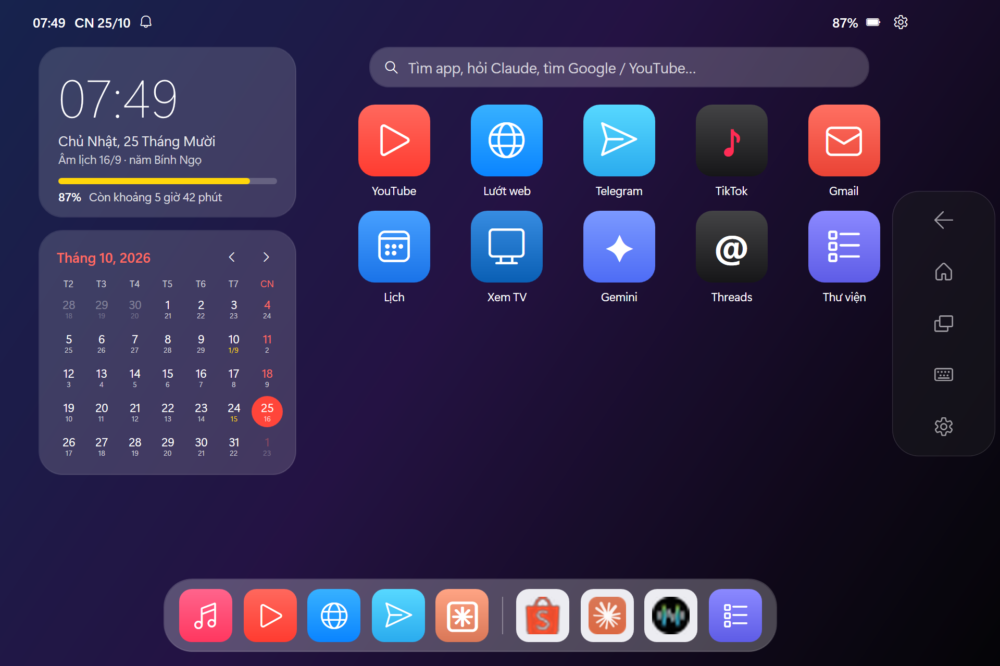
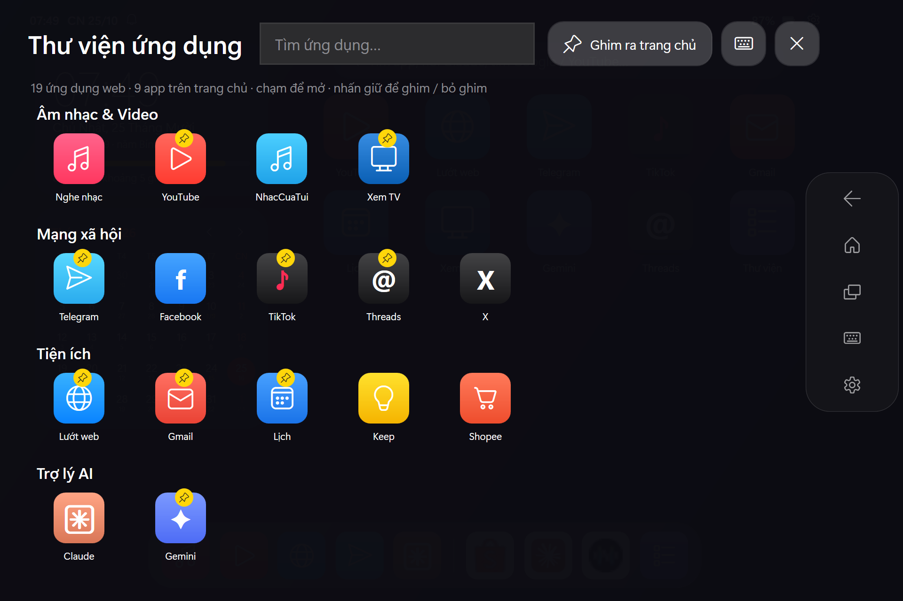
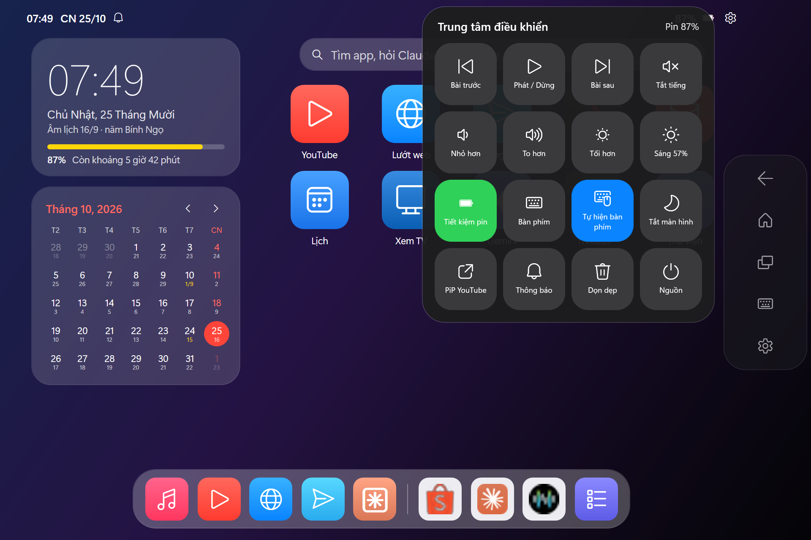
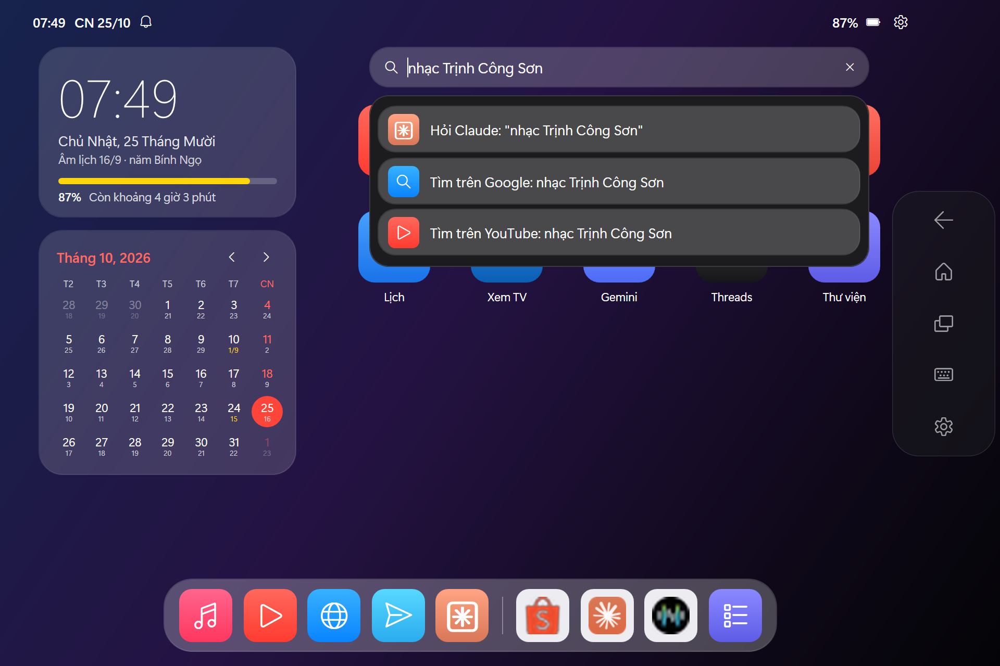

# Windows Tablet Launcher

**Biến laptop / máy tính bảng Windows cảm ứng thành "iPad"**: màn hình chính toàn màn hình, Dock, Thư viện ứng dụng, Trung tâm điều khiển, đa nhiệm, PiP YouTube, lịch âm, tiết kiệm pin — và cho **Claude** điều khiển máy qua MCP.

Chỉ cần PowerShell + WPF có sẵn trong Windows — **không cài thêm gì** để chạy launcher.

[🇻🇳 Tiếng Việt](#tiếng-việt) · [🇬🇧 English](#english)



| Thư viện ứng dụng — App Library | Trung tâm điều khiển — Control Center | Tìm kiếm & Hỏi Claude — Search |
|---|---|---|
|  |  |  |

---

## Tiếng Việt

### Tính năng
| Phần | Mô tả |
|---|---|
| Màn hình chính | Hình nền, thanh trạng thái, widget đồng hồ + pin, **lịch tháng có âm lịch**, icon bo góc, thanh tìm kiếm |
| Dock | App yêu thích + 3 app vừa dùng + Thư viện |
| Bộ sưu tập (Thư viện) | Mọi web app, chia nhóm (Âm nhạc & Video, Mạng xã hội, Tiện ích, AI, Trò chơi). Vuốt sang trái để mở |
| Ghim | **Nhấn giữ** app trong Thư viện để ghim ra trang chủ; nhấn giữ trên trang chủ để bỏ |
| Web app toàn màn hình | Mỗi app (YouTube, Telegram, Gmail…) mở thành cửa sổ riêng, tự phóng to; chạm lại thì chuyển tới cửa sổ đang mở |
| Thanh điều hướng nổi | Quay lại · Home · Đa nhiệm · Bàn phím · Trung tâm điều khiển — nổi trên mọi app, không lấy focus |
| Đa nhiệm | Thẻ xem trước trực tiếp (DWM), chạm để chuyển, ✕ để đóng |
| Trung tâm điều khiển | Nhạc, âm lượng, độ sáng, tiết kiệm pin, bàn phím, tắt màn hình (nhạc vẫn phát), PiP, thông báo, dọn dẹp, nguồn |
| PiP YouTube | Thu video thành khung nổi bo góc ở góc dưới |
| Bàn phím cảm ứng | Tự hiện khi chạm ô nhập chữ — hữu ích khi bàn phím vật lý hỏng |
| Thông báo | Vuốt xuống từ mép trên / chạm giờ → Trung tâm thông báo & lịch của Windows |
| Tìm kiếm | Tìm app, **Hỏi Claude**, tìm Google / YouTube |
| Tiết kiệm pin | Chế độ "Best power efficiency" + Energy Saver; launcher chạy EcoQoS, ưu tiên thấp, trả RAM khi ở nền |
| Dọn tiến trình | Đóng app nền thừa (OneDrive, Teams, Widgets…) kèm dung lượng RAM |
| Đang phát | Widget ảnh bìa, tên bài, nút điều khiển — lấy từ bộ điều khiển media của Windows (YouTube Music, NhacCuaTui, Spotify…) |
| Hẹn giờ tắt nhạc | Trung tâm điều khiển → Hẹn giờ tắt: 15 / 30 / 60 phút → dừng nhạc và tắt màn hình |
| Thêm app bằng địa chỉ | Thư viện → **+ Thêm app**: dán link, tự lấy tên và icon thật của trang; lưu ở `apps.user.json` |
| Chia đôi màn hình | Đa nhiệm → **Chia đôi** (hoặc Trung tâm điều khiển): 2 app gần nhất cạnh nhau, kéo thanh giữa để đổi tỉ lệ |
| Đồng hồ đầu giường | Đang sạc + không chạm 5 phút (hoặc bật tay): đồng hồ lớn, lịch âm, ảnh trong Pictures chạy lần lượt |
| Tự cập nhật | Bản .exe tự kiểm tra bản mới trên GitHub (tối đa 1 lần/ngày), bấm **Cập nhật** là xong |

### Yêu cầu
- Windows 10 / 11 (tối ưu cho màn hình cảm ứng)
- Google Chrome (khuyên dùng, để đồng bộ tài khoản Google) hoặc Microsoft Edge
- Python 3 — chỉ cần nếu dùng MCP cho Claude

### Cài đặt & chạy
**Cách nhanh nhất:** tải **[TouchLauncher.exe](https://github.com/npduylab/windows-tablet-launcher/releases/latest/download/TouchLauncher.exe)** (một tệp, khoảng 160 KB), rồi bấm đúp để chạy. Lần đầu chạy, exe tự giải nén vào `%LOCALAPPDATA%\TouchLauncher\app`; cấu hình nằm ở `launcher.config.json` trong thư mục đó. Khi tải bản mới, cấu hình cũ được giữ nguyên.
> Exe chưa được ký số nên Windows SmartScreen có thể cảnh báo: bấm **More info → Run anyway**. Mã nguồn của exe nằm trong `src/TouchLauncher.cs`, và bạn có thể tự build lại.

**Hoặc chạy từ mã nguồn:**
1. Tải về: **Code → Download ZIP** rồi giải nén (hoặc `git clone`).
2. Bấm đúp `ChayLauncher.cmd`.
3. (Tuỳ chọn) Tạo shortcut ngoài Desktop + tự chạy khi đăng nhập:
   ```powershell
   powershell -ExecutionPolicy Bypass -File CaiDat.ps1 -AutoStart
   ```

**Tự build exe** (dùng trình biên dịch C# có sẵn trong Windows, không cần Visual Studio):
```powershell
powershell -ExecutionPolicy Bypass -File build.ps1
```
Kết quả nằm ở `dist\TouchLauncher.exe`. Nếu chép exe vào cạnh `Launcher.ps1`, exe sẽ chạy bản script trong thư mục đó.

### Tuỳ chỉnh — `launcher.config.json`
- `tiles`: các app. `type`: `app` (web dạng ứng dụng) / `web` / `uri` / `exe`; `icon`: mã glyph Segoe Fluent (vd `E8D6`) hoặc một ký tự; `color`, `fg`; `group`: nhóm trong Thư viện; `match`: biểu thức tiêu đề cửa sổ để không mở trùng.
- `home`: app mặc định trên trang chủ (sau đó lưu ở `pinned.json`). `dock`: app trên Dock.
- `browser`: `chrome` / `edge`. `appWindowMode`: `maximized` / `normal`.
- `navBar.position`: `right` / `left` / `bottom`. `pip.position`: `bottom-right` / `bottom-left` / `top-right` / `top-left`.
- `autoKeyboard`: tự hiện bàn phím cảm ứng. `killList` / `killListOptional`: tiến trình cần dọn.
- `wallpaper`: đường dẫn ảnh nền. `claudeUrl`: địa chỉ "Hỏi Claude".
- `photoFolder`: thư mục ảnh cho đồng hồ đầu giường (mặc định: Pictures). `nightClock.auto` / `nightClock.idleMinutes`: tự bật khi đang sạc và không dùng N phút.
- `updateCheck`: `false` để tắt tự kiểm tra bản mới.

### Claude điều khiển máy (MCP)
`mcp/touch_launcher_mcp.py` là MCP server dùng thư viện chuẩn Python (không cần `pip`). Công cụ: `list_apps`, `open_app`, `search` (Google/YouTube/YouTube Music/Maps/Shopee), `open_url`, `media` (phát/dừng, bài, âm lượng), `set_brightness`, `get_status` (pin, giờ, cửa sổ), `list_windows`, `switch_window`, `close_window`, `go_home`, `open_notifications`.

Đăng ký với Claude Desktop (có sao lưu cấu hình cũ):
```powershell
powershell -ExecutionPolicy Bypass -File CaiMCP.ps1
```
Thoát hẳn Claude Desktop rồi mở lại, sau đó nói: *"Mở YouTube tìm nhạc Trịnh"*, *"Tăng âm lượng"*, *"Pin còn bao nhiêu?"*.

### Quyền riêng tư
Launcher không gửi dữ liệu đi đâu. Mọi thứ chạy trên máy bạn; đăng nhập các web app nằm trong trình duyệt của bạn.

### Đóng góp
Mọi đóng góp đều được chào đón: báo lỗi, đề xuất app web, sửa câu chữ, viết tính năng. Đọc [CONTRIBUTING.md](CONTRIBUTING.md) để bắt đầu. Việc dễ nhất cho người mới: thêm một app web vào `launcher.config.json`. Có câu hỏi thì vào [Discussions](https://github.com/npduylab/windows-tablet-launcher/discussions).

---

## English

**Turn a Windows touch laptop/tablet into an iPad-like device**: full-screen home screen, Dock, App Library, Control Center, multitasking with live previews, YouTube picture-in-picture, a month calendar with the Vietnamese lunar calendar, battery saving — plus an **MCP server so Claude can control the device**.

Runs on the PowerShell + WPF that ship with Windows — **nothing to install** for the launcher itself.

### Highlights
- **Home screen** with clock/battery/calendar widgets, rounded app icons and a search bar (find apps, *Ask Claude*, Google, YouTube).
- **App Library** of web apps grouped by category; **press and hold** to pin/unpin apps to the home screen.
- Web apps open as **standalone full-screen windows**; tapping an app that is already open switches to it.
- **Floating navigation bar** (Back · Home · Recents · Keyboard · Control Center) that never steals focus.
- **Control Center** floating over any app: media, volume, brightness, battery saver, touch keyboard, screen off (music keeps playing), PiP, notifications, cleanup, power.
- **YouTube PiP**: shrinks the YouTube window to a rounded floating video in a corner.
- **Touch keyboard** pops up automatically in text fields (handy when the physical keyboard is broken).
- **Battery saving**: "Best power efficiency" power mode + Energy Saver; the launcher itself runs with EcoQoS, low priority and trims its memory in the background.

### Requirements
Windows 10/11, Google Chrome (recommended) or Microsoft Edge. Python 3 only for the MCP server.

### Run
Easiest: download **[TouchLauncher.exe](https://github.com/npduylab/windows-tablet-launcher/releases/latest/download/TouchLauncher.exe)** (single file, ~160 KB) and double-click it. On first run it unpacks to `%LOCALAPPDATA%\TouchLauncher\app` (your config there survives updates). The exe is unsigned, so SmartScreen may warn: **More info → Run anyway**. Build it yourself with `powershell -ExecutionPolicy Bypass -File build.ps1`.

From source: download the ZIP (or `git clone`), then double-click `ChayLauncher.cmd`.
Optional desktop shortcut + autostart: `powershell -ExecutionPolicy Bypass -File CaiDat.ps1 -AutoStart`.

Everything is configured in `launcher.config.json` (apps, groups, home screen, Dock, browser, nav bar position, PiP position…). The UI is in Vietnamese; app names and labels are plain strings in the config and script, easy to translate.

### Claude / MCP
`mcp/touch_launcher_mcp.py` is a dependency-free MCP server (stdio). Register it with Claude Desktop via `powershell -ExecutionPolicy Bypass -File CaiMCP.ps1` (backs up the existing config), restart Claude Desktop, then ask things like *"Open YouTube and search for lo-fi music"* or *"How much battery is left?"*.
For Claude Code: `claude mcp add touch-launcher -- python -I path\to\mcp\touch_launcher_mcp.py`.

### Privacy
No telemetry, no network calls of its own. Everything runs locally; web app logins live in your browser.

### Contributing
Bug reports, web-app suggestions, translations and features are welcome — see [CONTRIBUTING.md](CONTRIBUTING.md). Questions go to [Discussions](https://github.com/npduylab/windows-tablet-launcher/discussions).

## License
[MIT](LICENSE)
